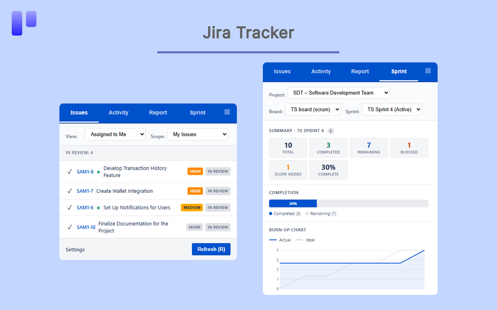
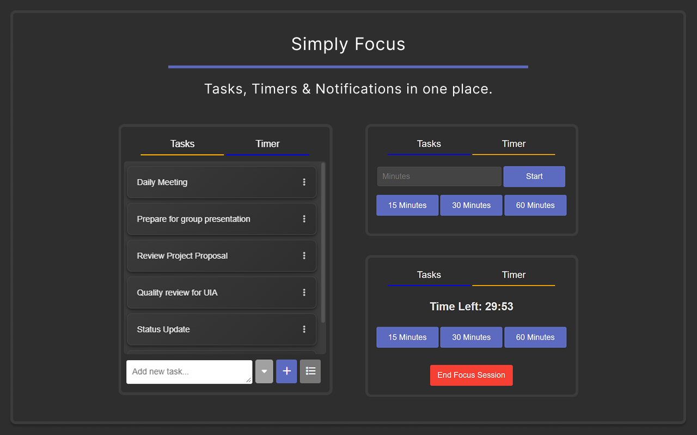
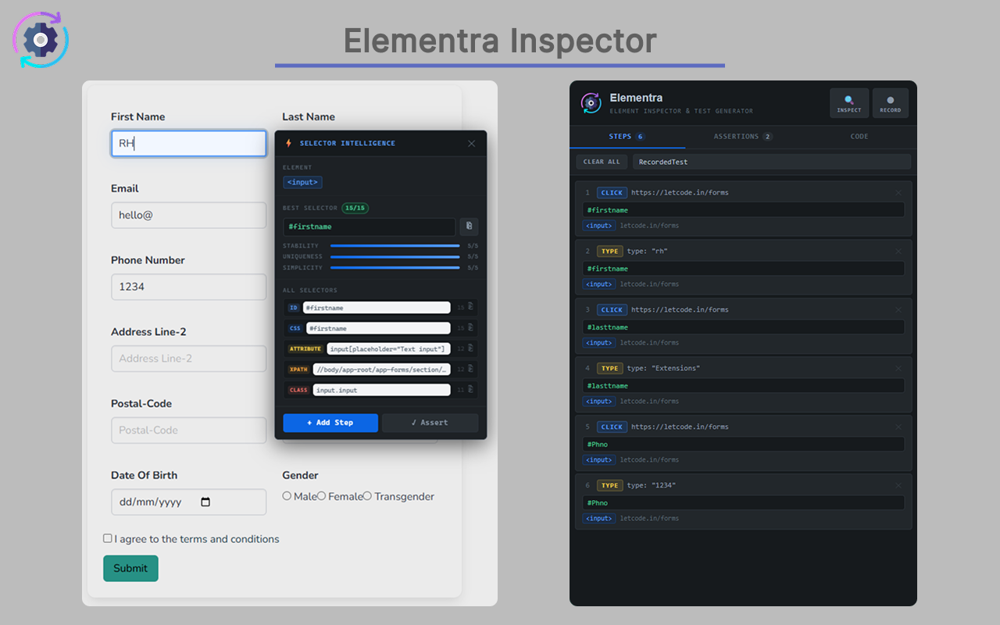

# 🧩 Chrome Extensions

A collection of Chrome extensions I've built to solve real productivity and developer workflow problems. Each one started as something I personally needed - and turned into a proper published tool.

---

## Extensions

### ⚡ Jira Tracker - Fast Issue Tracking for Developers
> Track and manage Jira issues without leaving your browser.

Built out of frustration with constantly switching tabs during development. Jira Tracker gives team members fast access to their issues, updates, and ticket status directly from the Chrome toolbar.

**Tech:** `JavaScript` `Chrome APIs` `Manifest V3` `Jira REST API`

---

### 🎯 Simply Focus - Smart Time & Task Manager
> A smarter way to manage your time and stay on task.

A productivity extension built around time management principles - helping you structure your work sessions, track tasks, and stay focused without the noise of a full-blown app.

**Tech:** `JavaScript` `HTML` `CSS` `Chrome Storage API`

---

### 🔬 Elementra - Element & Test Automation *(Under Review)*
> Browser-based element inspection and test automation tooling.

Elementra is my most technically ambitious extension - born directly from my QA work. It assists with element selection, inspection, and building automation test cases from within the browser, with its own code generation.

**Tech:** `JavaScript` `Chrome DevTools Protocol` `DOM APIs` `Manifest V3`

---

## Screenshots

---

## Why I build extensions

Chrome extensions sit right at the intersection of web development and browser security - you're working directly with APIs that touch tab management, storage, network requests, and page content. For someone interested in cybersecurity, it's a genuinely interesting space to build in, and it allows me to develop my programming skills.

---

## 📬 Get in touch

- 💼 [LinkedIn](https://www.linkedin.com/in/robert-hughes)
- 📧 robertmarkhughes2@gmail.com
