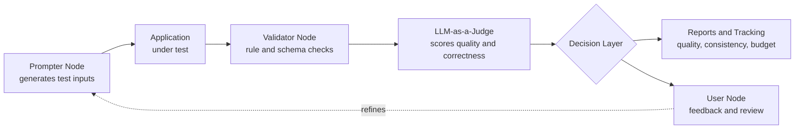

# Hi, I'm Rob 👋

### Cybersecurity graduate · QA Engineer · Aspiring Security Professional

---

I'm a BSc Cyber Security (First-Class Honours) graduate from Manchester Metropolitan University, currently working as a QA Engineer on financial software. My day-to-day covers manual, automated, and security testing, and more recently AI quality and security assurance.

This repo is a showcase of my university work, professional-style projects, and side builds.

|  |  |
|---|---|
| 🎓 **Education** | BSc Cyber Security, First-Class Honours, Manchester Metropolitan University |
| 💼 **Currently** | QA Engineer (manual, automated and security testing, AI assurance) |
| 🎯 **Looking for** | Cyber security roles |
| 📍 **Location** | Manchester, UK |
---

## ⭐ Featured Project

### AI QA Test Harness: LLM Quality & Security Assurance

> An in-house test harness I designed and built to assess AI-powered applications for security, quality, consistency and accuracy, acting as a decision-making layer between the system under test and the people responsible for it.

Testing LLM-backed features is different from testing deterministic software: the same input can produce different outputs, and "correct" is often a judgement call. I built the harness to make that measurable and repeatable.

**How it works**

**What it covers**

| Area | What the harness does |
|---|---|
| **AI security** | Adversarial and misuse-style prompts to probe for unsafe or unintended behaviour |
| **Accuracy & incorrectness** | Detects wrong, hallucinated or off-spec responses |
| **Consistency** | Repeated runs to measure response stability across the same inputs |
| **Test data generation** | Automatically generates varied, targeted test data per application |
| **LLM-as-a-judge** | Automated scoring against defined criteria, with human feedback loop |
| **Budget & usage tracking** | Tracks token usage and cost per run so quality can be weighed against spend |
| **Reporting** | Quality, consistency and tracking information fed back to users |

**Highlights**
- Designed as a modular, node-based architecture (prompter, validator, judge, user), so each stage can be configured per application
- Built and adopted across multiple applications, adapting to each one's needs
- Has its own dedicated test coverage, because a test tool should be tested too
- Results: Detected significant consistency issues, raised with Production, and validated the fixes to bring the AI to a 95% consistency range.

`AI Harness` `LLM-as-a-Judge` `Test Automation` `AI Security` `Prompt Testing` `Test Data Generation`

> _Built for an employer, so implementation details are kept high-level here. Happy to talk through the design in more depth._

---

## More Projects

<b>SMS Fraud Detection: ML Dissertation (First-Class)</b>

 

Final-year dissertation: a machine learning model that detects SMS-based fraud (smishing). Covers data preprocessing, feature engineering, model training and evaluation.

- **Result:** 95% Precision
- **Models compared:** Naïve Bayes Classifier & Fast Forest OVA

`Python` `scikit-learn` `NLP` `Classification`
 
[Go to Repo](./ML-SMS-Fraud-Detection)

<b>Network Design & Implementation</b>

 

Full network design for a 50-employee organisation across two floors, built and verified in Cisco Packet Tracer.

- CIDR addressing and subnetting
- SSH hardening, DHCP, RIP routing
- Redundancy and full connectivity testing

`Cisco Packet Tracer` `SSH` `DHCP` `RIP` `CIDR` `Cisco IOS`
 
[Go to Repo](./Network%20Design%20%26%20Implementation)

<b>Applied Cryptography</b>

 

Core cryptographic concepts implemented from scratch in Python: Euclidean and Extended Euclidean algorithms, Fermat's Little Theorem, repeated squaring, and a full walkthrough of one round of DES.

`Python` `Jupyter Notebook` `SymPy` `Number Theory` `DES`
 
[Go to Repo](./Applied-Cryptography)

<b>Chrome Productivity Extensions</b>

 

Browser extensions I built to solve my own time-management problems, a practical way to keep developing my programming skills outside of work.

`JavaScript` `HTML` `Chrome APIs` `Manifest V3`
 
[Go to Repo](./Chrome-Extension-Projects)

---

## Tools & Languages

**Languages**

**Security**

**QA & Dev**

---

### Get in touch 👋

If you're hiring for a security role or just want to chat about security, testing, and AI, I'd love to hear from you.

